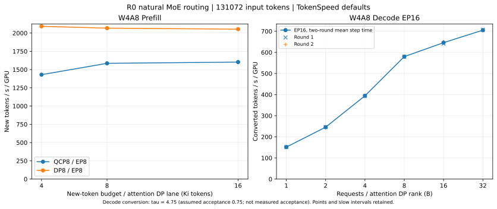

# 本轮 W4A8 结果

三条曲线均来自本轮当前协议的实际测量，已完成闭合原件和独立交叉审核。诊断trace另行采集，不能替换正式成绩。

- [Prefill QCP8与DP8](prefill/README.md)：4K/8K/16K新增预算，真实原生prefix cache，新增与物理计算行分别报告；每点完整10间隔与所有attention DP lane分布均保留。
- [Decode EP16](decode/README.md)：B1/2/4/8/16/32，双轮固定global满载窗口。全16rank相同step交集后各跳100再取51点；192个formal和96个warm窗口经两份独立实现交叉审核，慢尾保留。

[现有Elastic数值验证](elastic-validation.json)在两节点16rank完成原样9case（144次rank-case执行），严格0容差、零失败/错误/跳过，包含改变路由和输入的CUDA graph replay；它是当前算子数值覆盖，不是第四条性能曲线。

方法由[运行入口](../SKILL.md)维护，各曲线记录真实源码、制品、权重、Indexer与通信身份。Prefill为无固定接受的1-token请求；Decode的tau4.75是吞吐换算假设，不能当实际接受率或精度。质量结果见[Longdoc](../../../eval/longdoc/w4a8/README.md)与[MMMU-Pro](../../../eval/mmmu-pro/w4a8/README.md)。

QCP8随预算增加为1430.02/1585.36/1602.65新token/s/GPU；DP8为2092.24/2066.93/2053.25，后者下降1.86%；EP16换算吞吐随B从151.47升至705.39token/s/GPU。所有慢点均保留。[统一分析](analysis.md)定位了捕获的180ms慢步中DeepEP dispatch/PDL释放约66.438ms的额外关键路径；内部等待源、缺失rank与采集边界等限制明确列出，不宣称所有底层原因已解决。

[SVG](curves.svg) / [PNG](curves.png)是独立可导出图。[plot.py](plot.py)从本目录CSV原样画点，显示Decode双轮及合并均值，不拟合或填缺点。使用独立venv安装[精确绘图依赖](requirements-plot.txt)，执行`python plot.py`即可重建。原始中间记录、完整回答、trace与绝对机器信息留在私有运行目录。
