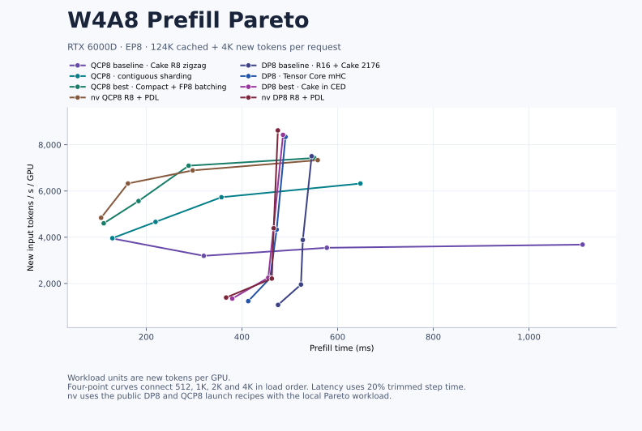
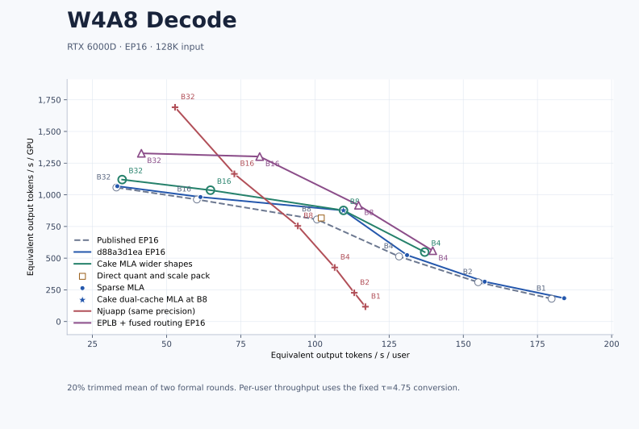

# DSV4.1 Flash W4A8 · RTX 6000D 性能

本页汇总 RTX 6000D 上 W4A8 的 QCP8 与 DP8 Prefill，以及双机 DP16/EP16 Decode。双机 Decode 的测量和质量记录沿用原口径。

## Prefill



[当前四档出图数据](prefill-current.json) · [历史 CSV](prefill.csv) · [原始采样协议](../prefill/README.md)

所有当前点用相同的单步负载。每条请求含 126,976 缓存 token、4,096 新 token 和 128 行 Encoder replay。512、1K、2K、4K 的标签为全机新增量除以八。横轴是正式十步间隔的 20% 截尾均值。图中每组四个圆点按负载顺序相连。

| 当前配置 | 512 | 1K | 2K | 4K |
| --- | ---: | ---: | ---: | ---: |
| QCP8 · Compact＋FP8 batching | 111.220 ms | 183.965 ms | 288.689 ms | 551.505 ms |
| nv QCP8 R8＋PDL | 105.748 ms | 161.879 ms | 297.193 ms | 558.472 ms |
| DP8 · Cake in CED | 379.788 ms | 455.081 ms | 466.049 ms | 485.953 ms |
| nv DP8 R8＋PDL | 367.036 ms | 462.475 ms | 466.533 ms | 475.206 ms |

QCP8 从全层 Cake R8 与 zigzag 开始，连续分片把 4K 从 1,112.1 降至 647.7 ms。当前配置再启用 Tensor Core mHC、Compact、Cake 4224、2 GiB Indexer logits 上限和 canonical group32 FP8 批处理。DP8 从固定 R16 与 Cake 2176 开始，加入 Cake 4224、group32 批处理与 Tensor Core mHC 后，4K 为 491.1 ms。继续启用 mHC post＋RMSNorm 融合和 CED Cake 后为 486.0 ms。nv 曲线使用公开 QCP8 和 ADP8 启动配方与同一采样负载。

### 历史在线 EPLB 结果

| 每卡新增 token | 在线 EPLB R16，ms | 新 token/s/GPU |
| ---: | ---: | ---: |
| 512 | 495.106 | 1,034.123 |
| 1,024 | 553.635 | 1,849.596 |
| 2,048 | 567.894 | 3,606.304 |
| 4,096 | 584.335 | 7,009.678 |
| 8,192 | 1,311.681 | 6,245.423 |

每条活跃 lane 的请求复用 126,976 个已缓存 token，新增 4,096 个 token，另有 128 行 replay。512、1K、2K、4K 各有 1、2、4、8 条活跃 lane，以全机新增量除以八计算标签。4K 使用 4,224 行外层分块，Cake routed MoE 在前 20 层使用 1,024 行内部块。Attention 使用 Native FP4 Indexer、单请求 Paged 路径和符合条件的 Compact BF16x2 路径。4K 发布点为 1,417.562 ms，紫线为 584.335 ms，步时下降 58.8%，每卡新增吞吐约为发布点的 2.43 倍。这组版本对比包含 Attention、MoE、专家放置与运行配置的变化。

紫线 8K 的每卡两条请求分两次 4K forward 完成，呈现从客户端提交到整组完成的时间。CSV 另收录 1,551.970 ms 的 8K 单步测量，`measurement` 标明两种计时边界。

从独立路由样本拟合的固定 R16 在同机 4K 测得 577.838 ms 截尾步时，比在线 R16 低约 1.1%。加载检查覆盖 40 层、8 卡及静态就近路由。此数据来自单档消融，默认配方采用在线 R16。

## Decode



[CSV](decode.csv) · [逐点间隔与运行参数](points.json) · [双机启动与审核](../decode/README.md)

| 请求数/卡 | Published，ms | 在线 EPLB R16 + 融合路由，ms |
| ---: | ---: | ---: |
| B1 | 26.423 | — |
| B2 | 30.644 | — |
| B4 | 37.010 | 34.001 |
| B8 | 47.179 | 41.419 |
| B16 | 78.913 | 58.378 |
| B32 | 143.707 | 114.498 |

双机共 16 卡。每请求实存 124,416 token 前缀，另有 6,656 token 唯一后缀。正式测量的验证与保留宽度固定为 6。图的等效输出速度使用统一换算系数 4.75，横轴为每用户速度，纵轴为每 GPU 吞吐。B8 和 B32 相对发布点的步时分别下降 12.2% 和 20.3%。Decode 使用 DeepGEMM / DeepSelect Indexer、按形状选择的 Cake BF16 MLA、静态 EPLB 路由融合以及 Elastic routed MoE，与独立流上的 shared expert 重叠。

历史对照的 nv 序列固定公开源码 [c52f86bfa](https://github.com/Njuapp/tokenspeed/tree/c52f86bfa5a8fc2ee79424a3f8bd933cfe4b0752)，采用相同精度和本页的输入及取样口径。Prefill R8 表由独立的 4K 路由统计重建。nv 的 B32 为 89.902 ms，在两侧已形成的完整引擎配置下比本分支当前点快 21.5%。该对比包含 MegaMoE、Indexer 及运行配置差异，尚未完成同引擎的算子归因。

## 质量与部署范围

在真实 P/D 链路上，EPLB 候选的三轮固定回归共完成 780 个请求。Longdoc50 为 **60.6207 分**，前一候选为 60.2426 分。MMMU 固定 210 题为 **55.2381%**，前一候选为 58.5714%，下降 **3.33 个百分点**。部署配置保留这一质量差异供选择版本时参考。

部署使用实际采样与接受逻辑。Pareto 在隔离的离线引擎上使用固定接受宽度。公开部署入口通过本机参数与模型预检，三节点联通和平台上线各自需要实际环境验收。[部署入口](../../../../deploy/w4a8/launch/README.md#dp8ep8-prefill--dp16ep16-decode) · [构建依赖](../../../../deploy/setup/README.md)

## 历史在线 EPLB 复测

使用同一源码构建 Prefill 和 Decode。沿用各自正式协议的随机 ID、真实缓存前缀及审计窗口。两角色均配置 16 个冗余槽、静态分流、2048 forward 的重平衡周期、每批四层，正式采样前另做至少 224 forwards 的 EPLB 预热，并核对各 rank 已应用布局。

### Prefill 4K

完成[节点环境](../README.md#节点环境)设置后，从仓库根目录执行。512、1K、2K 改用对应 label 和 `points.json` 中的队列及上下文配置。

```bash
BENCH=.agents/bench/pareto/w4a8/prefill
OUT="$PWD/_local/dp8-eplb-4k"
export TOKENSPEED_ENABLE_SM120_PAGED_PREFILL=1 TOKENSPEED_SM120_PREFILL_COMPACT_BF16X2=1
export TOKENSPEED_SM120_PREFILL_CAKE_ROWS=1024
"$VENV/bin/python" "$BENCH/run_point.py" --layout dp8 --label 4096 \
  --model "$MODEL_PATH" --python "$VENV/bin/python" --expert-routing natural \
  --indexer native-fp4 --gpu-memory-utilization 0.95 --profile-steps 0 \
  --queue-requests-per-lane 64 --max-model-len 1048576 --out "$OUT" \
  --redundant-experts 16 --ep-dispatch static --eplb-warmup-forwards 224 \
  --eplb-interval 2048 --eplb-layers-per-chunk 4
"$VENV/bin/python" "$BENCH/audit_point.py" --point "$OUT"
```

把 label 改成 8192 运行的是 8448 行单步档。历史 8K 两步档使用 4224 行上限，每卡两条请求，按整组提交到最后返回计时，并核对恰好两次全八卡满载 Prefill dispatch。8K 的实际 KV 容量和计时边界按历史数据记录。

### Decode B8 与 B32

依照[双机启动与审核](../decode/README.md)生成运行身份，使用同样的模型、网络、容量和采样设置。要逐档匹配历史 EPLB 校准，从新引擎分别启动 B8 与 B32。控制器命令使用相应的 `--batches 8` 或 `--batches 32`。控制器和两端引擎启动前设置以下变量。

```bash
export PARETO_EPLB_WARMUP_FORWARDS=224 PARETO_EPLB_DISPATCH=static
export PARETO_EPLB_REDUNDANT=16 PARETO_EPLB_INTERVAL=2048 PARETO_EPLB_LAYERS_PER_CHUNK=4
export TOKENSPEED_EXPERIMENT_SM120_FUSED_SCALE_PACK=1 TOKENSPEED_EXPERIMENT_SM120_QUANT_PACK=1
export TOKENSPEED_SM120_CAKE_DECODE_MLA=1 TOKENSPEED_SM120_CAKE_DECODE_MLA_WIDE=1
export TOKENSPEED_SM120_EPLB_FUSED_RECORD=1
```

保持引擎的 graph/驻留上限参数为 256。两端日志应记录 `Expert rebalance 1 applied`。用两个节点的运行目录重新执行同一审核器，再从两个正式轮的 100 个间隔计算截尾步时。

## 重新出图

从仓库根目录执行。脚本从 `prefill-current.json` 生成四档 Prefill 图，从 `points.json` 和上一级的发布测点生成 Decode 图、历史 CSV 与 `prefill-historical.svg`。额外加 `--full-prefill-plot` 可在历史图中绘制全部档位。

```bash
BENCH=.agents/bench/pareto/w4a8
python3.12 -m venv _local/pareto-plot
_local/pareto-plot/bin/python -m pip install -r "$BENCH/requirements-plot.txt"
_local/pareto-plot/bin/python "$BENCH/optimized/render.py" \
  --bench "$BENCH" --out _local/optimized-pareto
```
