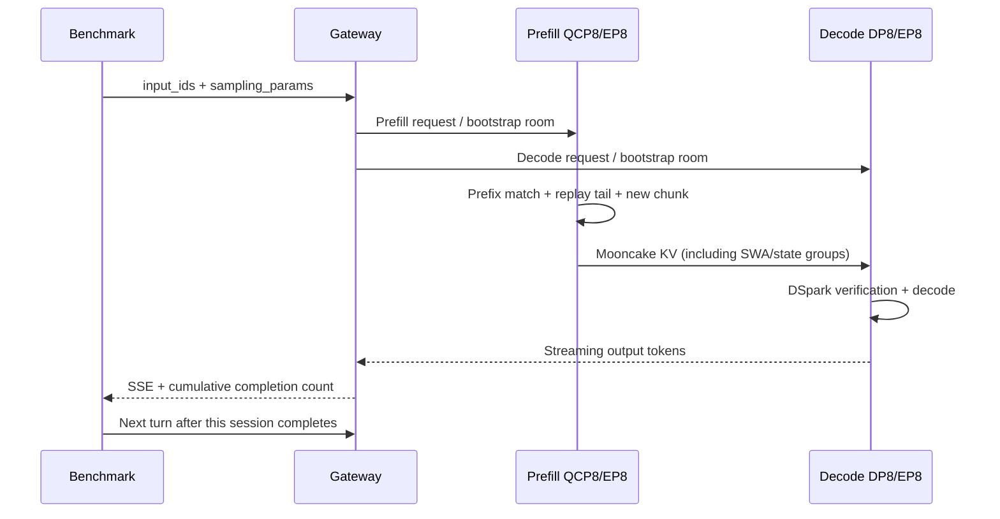

# PD 部署检查与测试流程

## 组件和环境

P、D 分别使用所在 TS checkout 构建 engine/scheduler。P 需要 model-wide QCP + 正常 PD/DSpark 修复以及 cache flush RPC；D 需要 SM120 FlashInfer/DeepEP 和相同控制协议；版本锚点见 dependencies.tsv。Gateway 是独立 SMG 项目，从 ssh://git@git.sankuai.com/~wangchangran/gateway.git 拉取，固定 c52056d4c00a1bccd69836b466e5565ba26c13f0（核对时 main 的 HEAD）。原 gateway.bundle 仅作为可选离线备份，不再是安装所需制品。它负责请求路由和控制 RPC，KV 经 Mooncake 从 P 直接传 D，数据不经 Gateway。

两台机器各 8 张 SM120 GPU，CUDA 13、Python 3.12、CUDA 13 PyTorch；主机 RAM 要能容纳 host Engram。模型两端均为 DeepSeek-V4.1-Flash-1017。建议模型、编译 cache 和依赖源码都放本地磁盘；权重文件必须完整，P/D tokenizer 配置一致。模型体积过大，本目录不打包权重；显式设置 MODEL_PATH。

复制目录→env.example.sh 配置→install.sh 建新环境→prepare_artifacts.sh→fetch_sources.sh→P build_nvshmem.sh→install_dependencies.sh→check.sh。Gateway 单独配置 ROLE=gateway；build/install 从 Git 拉取的源码。安装使用固定版本 wheel，包镜像和代理在机器环境中配置，不写凭据入 Git。已在独立新虚拟环境中完成安装、启动及真实 PD 小请求验证；仍依赖目标机器提供兼容驱动、CUDA 和 RDMA 系统库。

## 启动与网络

先启动 Gateway，然后 P/D 可并行启动。两个 headless worker 均连接 GATEWAY_HOST：18510 为 P、18511 为 D。HTTP 18500 接收 /generate 或 OpenAI 请求；P bootstrap 18598 用于 KV 传输引导。使用目标网卡名设置 EP_NIC_NAME/NCCL_IB_HCA，确认两机 RDMA、GPU P2P 和 Mooncake 注册正常。不要直接复制其他机器的网卡编号。原测试使用 RDMA、NCCL_P2P_DISABLE=1、NCCL_SHM_DISABLE=1；这些是拓扑相关选择。

进程前台运行，日志由调用者保存，例如 `bash deploy/dsv41_pd/launch_decode.sh > decode.log 2>&1`；需要断网后继续可使用 tmux、systemd 或 nohup。不要把环境安装与正在运行的服务共用 venv。此目录没有自动 kill/restart 逻辑。

## 请求流转

P prefix cache 开启，D prefix cache 关闭；上一轮输出不拼入下次输入。保留完整输入前缀，追加新的 10240 token。SWA/压缩状态的 bounded replay 会使实际计算包含额外尾部 token，不等于 prefix 未命中。

## 验收和复测

1. `check.sh` 检查导入位置、GPU、当前 commit 和 ts-host；记录完整版本与 nvidia-smi。
2. `/workers` 必须看到健康 P/D，`smoke.sh` 验证流式服务的基础连通性。真实精度测试必须保持 SIMULATED_ACCEPT_LEN 为空；短 smoke 并不能证明长上下文精度。
3. `benchmark.sh` 使用新结果目录，C1–C32 每档两次完整 100K→200K 预热，清 KV 后正式测。不会清磁盘 JIT cache，也不重启 P。
4. 逐请求检查输出 4096、输入 token 数、cached_tokens；失败停止并保留数据。正式轮要检查服务日志有无 JIT、超时、OOM 或重试。clear-cache 仅接受两个 worker 都已处理的成功返回。
5. 汇总每轮 TTFT/TPOT mean/p50/p95、整组输出窗口吞吐。不是满 BS 测量，不把 submitted concurrency 作为真实 decode batch。接受率、真实 BS 和 KV 峰值要额外用服务计数核对；当前移植不包含旧观察器的隐式 monkeypatch。

默认 10 轮、4096 输出可在环境配置中修改。模拟 accepted length=4 是性能专用，不保证生成内容正确；6 个验证位置中含 1 个 anchor，draft 接受率约 (4−1)/(6−1)=60%。准确率评测使用自然输出与独立题目数据，不能从固定长度压测推导准确率。

## D 专用依赖与校验

D 的 DeepGEMM/CUTLASS 固定 Git revision；安装强制源码编译，不复用下载的 wheel。DeepGEMM 的本地修改是 C++20 构建和 lambda 捕获兼容修复，不是 FP4 Indexer 开关。DeepEP 使用固定 wheel，安装后对 Python tuner 应用补丁：重复应用识别为已完成，源码冲突则中止。D 无需 P 的三份定制源码。

D 运行使用 FlashInfer 0.7.2、tokenspeed-deepep 2.1.0.post20260810、tokenspeed-mooncake 0.3.13.post20261026。check.sh 检查这些版本、实际导入位置、DeepEP 补丁、host binary 和 GPU。源码构建仍需用新环境启动验收；版本检查不能替代算子精度与 PD 连通测试。

CUDA_HOME 必须指向完整可用的 CUDA 13 工具链，包含 nvcc、ptxas、cuobjdump、headers 和 libraries。CUDA_TOOLKIT_MODE=system 使用目标机器工具链；python 模式由部署在当前 VENV 中安装，并通过 prepare_cuda_tools.sh 补齐所需工具及链接。两种模式都不引用旧环境。JIT/cache 默认位于 STATE_DIR，建议使用本地磁盘；共享 STATE_DIR 可通过 PD_TRITON_CACHE_DIR 单独选择节点本地 Triton 缓存。

## 首轮 TTFT 与 prime 同步对照

原 10 轮方案中，各会话完成自己的 100K prime（同样输出 4096 token）后立即提交 110K 请求，不等待其他会话。C32 的快速会话进入正式轮时，P 仍在处理其他会话的 100K 冷输入，因此首轮包含明显的接纳前等待。

已完成的两次完整预热后复测结果：

| 指标 | 数值 |
| --- | ---: |
| 首轮 110K 平均 TTFT | 13.243 s |
| 首轮 TTFT P50 / P95 | 2.233 / 44.671 s |
| 提交至 P commit_ts 平均时间 | 12.245 s |
| P commit_ts 至客户端首 token 平均时间 | 0.998 s |
| P 日志记录的平均 prefill 计算时间 | 0.653 s |
| 按提交顺序前 16 条 / 后 16 条平均 TTFT | 25.789 / 0.697 s |
| 后续 9 轮平均 TTFT | 0.910 s |
| 全部 10 轮平均整请求 TPOT | 14.725 ms |
| 全组实测输出吞吐 | 1990.43 token/s |
| 最大观测全局 decode BS | 32 |
| 模拟 draft 接受率 | 59.98% |

首轮 32 条请求均命中 102400 token 前缀缓存；含 prime 的正式时间窗内，JIT 审计未发现 ≥100 ms 的显著编译。最慢请求 TTFT 为 50.324 s，其中提交至 P commit_ts 约 49.164 s，P 记录的 prefill 计算仅 557 ms。P 监控在此期间曾有约 18 条等待请求。

提交至 commit_ts 涵盖客户端、网络、Gateway 和 P 接纳等待，并非纯 scheduler 排队计时；跨节点时间戳也有时钟偏差。P 日志的 prefill_ms 属于执行阶段，不能再与上述两个时间段相加。日志中 queue_ms=0、recv_ts=0 不能用来证明没有排队。证据主要支持冷 prefill 积压，不支持把首轮高 TTFT 归因于显著 JIT 或 prefix cache 失效。

### 新增对照：prime 完成后统一进入正式轮

为测量“全部前缀已准备好”的多轮性能，新增如下对照协议：

1. C 个会话同时提交 100K prime，每个请求仍输出 4096 token。
2. 等待全部 C 个 prime 请求完整结束，才允许任一会话提交 110K。
3. 从 110K 开始，各会话仍独立推进：本轮结束立即发下一轮，直到 200K；正式轮之间不再设置同步屏障。
4. 每个并发先做两次同协议的完整预热，各次之间确认服务空闲并清理 P/D KV，保留 JIT 缓存；再执行一次正式测试。
5. 仍使用相同 32 条数据、C32、4K 输出和 accepted length=4（约 60% draft 接受率）；不改变服务参数。
6. 单独保存结果，检查最早的正式请求 start 不早于最后一个 prime 的 end；首轮缓存必须命中 100K，并审计 JIT、实际 decode BS 和接受率。

新协议移除了 cold-prime 与正式轮的重叠，但同步后的 32 条 10K 增量请求也会同时到达 P，因此不能预先保证首轮 TTFT 接近后续轮。它测的是预先建好全部 prefix 的负载；原协议测的是冷启动逐步进入多轮的负载，两者应单独标注。

**状态：** 已启动 C32 对照，启动时 P/D 健康且空闲，清缓存接口确认两端均成功；截至本次文档更新，仅确认进入完整预热，尚未取得可引用的新正式结果。上表全部来自已完成的原协议复测，不是新屏障方案的结果。

**部署入口边界：** 当前已提交的 benchmark.sh / bench.py 仍采用原独立推进协议；新增屏障先在独立实验脚本中验证，尚未合入部署入口。不要仅因文档出现新协议，就认为直接执行 benchmark.sh 会启用 prime 屏障。此次更新仅修改文档。

安装过程中的实际问题、修复与验收状态见 [安装问题记录](INSTALL_TROUBLESHOOTING.md)。失败续装使用 install.sh --resume，仅限本次独立部署环境。
